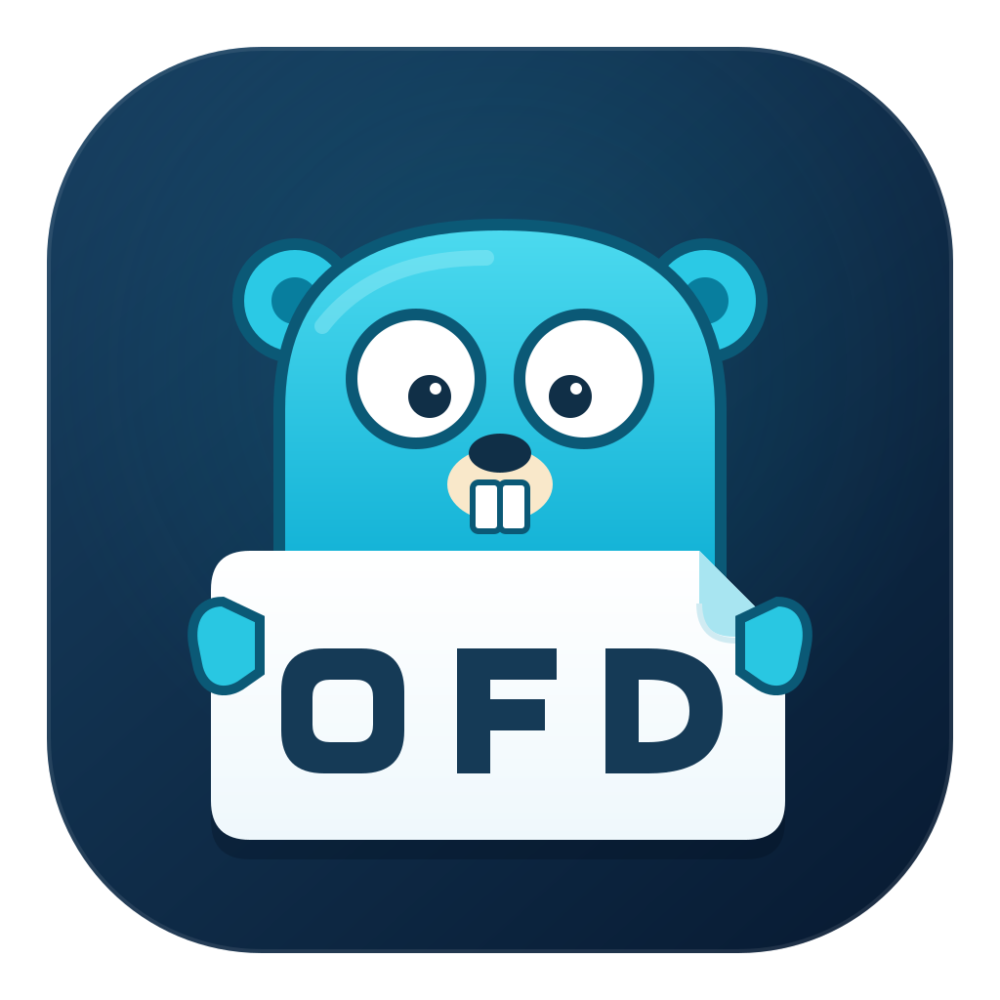

<p align="center">
  <a href="docs/branding/README.md">
    
  </a>
</p>

<h1 align="center">OFD Go Toolkit</h1>

<p align="center">
  <a href="https://pkg.go.dev/github.com/zc310/ofd"></a>
  <a href="https://github.com/zc310/ofd/releases/latest"></a>
  <a href="https://github.com/zc310/ofd/actions/workflows/go.yml"></a>
  <a href="https://coveralls.io/github/zc310/ofd?branch=main"></a>
  <a href="https://github.com/zc310/ofd/stargazers"></a>
</p>

用 Go 解析、创建、转换、渲染、校验和分析 OFD 文档。提供 Go API、命令行工具、
HTTP 服务，以及桌面、Android 和浏览器阅读器。

| 想做什么 | 入口 |
|---|---|
| 在线体验 | [OFD Toolbox](https://zc310.github.io/ofd-toolbox/)（覆盖本库大部分功能）；[浏览器阅读器](https://zc310.github.io/ofd/wasm/)；[Fyne Web 阅读器](https://zc310.github.io/ofd/fyne/) |
| 下载应用或命令行工具 | [GitHub Releases](https://github.com/zc310/ofd/releases) |
| 转换、创建和检查文档 | [快速开始](#快速开始)、[功能特性](#功能特性) |
| 接入自己的 Go 项目 | [Go API](#go-api)、[库使用指南](docs/GO-API.md) |
| 从源码运行和打包 | [构建与打包](#构建与打包)、[构建指南](docs/BUILDING.md) |
| 查询兼容性与标准资料 | [支持清单](#支持清单与工具文档)、[文档目录](docs/README.md) |

## 快速开始

下载 [Release](https://github.com/zc310/ofd/releases) 中对应平台的命令行程序后运行：

```bash
# OFD 转 PDF
ofd-converter input.ofd output.pdf

# 首页输出为 PNG；页码从 1 开始
ofd-converter --page 1 --dpi 150 input.ofd page1.png

# 多页图片输出为 ZIP
ofd-converter --format png input.ofd pages.zip

# PDF 转 OFD
ofd-converter input.pdf output.ofd

# CSV / TSV 表格转 OFD，长表自动分页并重复表头
ofd-converter inventory.csv /tmp/inventory.ofd
ofd-converter --landscape inventory.tsv /tmp/inventory.ofd

# 邮件和 SVG 转 OFD，需要本机 Chrome/Chromium
ofd-converter message.eml /tmp/message.ofd
ofd-converter --landscape drawing.svg /tmp/drawing.ofd

# 从 YAML 或 JSON 清单创建 OFD
ofd-creator -i document.yaml -o result.ofd --validate

# 校验与分析
ofd-validator --format text input.ofd
ofd-analyzer --format json input.ofd

# 加密与解密；口令文件按原始 UTF-8 字节读取
ofd-crypt encrypt --password-file password.txt -o encrypted.ofd input.ofd
ofd-crypt decrypt --password-file password.txt -o plain.ofd encrypted.ofd

# 多份文档与第一份比较，生成可离线查看的图文差异报告
ofd-compare -o comparison.html original.ofd revised.ofd final.ofd
```

从源码运行时，在仓库根目录将程序名替换为 `go run ./cmd/工具名`，例如：

```bash
go run ./cmd/ofd-converter testdata/ofd-creator/helloworld.ofd /tmp/helloworld.pdf
```

GM/T 0099-2020 加解密使用不提供认证的 CBC；解密成功不证明内容未被篡改、证书可信或签名有效。
重要场景请独立验证签名和完整性证据，详见[密码功能与实现约定](docs/OFD-CRYPTO.md)及[免责声明](DISCLAIMER.md)。

`ofd-converter` 默认使用 150 DPI 和白色背景，`--page` 使用多文档体合并后的全局页码。
批量转换、完整选项和退出码见 [转换工具说明](cmd/ofd-converter/README.md)；
创建清单见 [creator 示例](cmd/ofd-creator/examples)，大对比报告可使用
[`--external-images`](cmd/ofd-compare/README.md) 将图片保存到报告旁。

常规 OFD 转 PDF、图片及 PDF、CSV/TSV 导入使用 Go 实现。Office、HTML、EML、SVG、XPS 和 OCR 的
外部工具要求见 [运行依赖](docs/BUILDING.md#运行依赖)，PDF 的可选 OpenJPEG 后端见
[PDF 支持清单](docs/PDF-SUPPORT.md)。

## 功能特性

| 场景 | 能力与工具 |
|---|---|
| 文档转换 | [ofd-converter](cmd/ofd-converter/README.md)：OFD 转 PDF、DOCX、HTML、文本、Markdown、PNG/JPG、TIFF、SVG、EPS、TeX；EML/SVG/CSV/TSV/PDF/XPS/Markdown/Office/HTML/图片转 OFD。 |
| 创建与编辑 | [ofd-creator](cmd/ofd-creator/README.md)：JSON/YAML 清单创建、流式自动排版、Material/Material 2/Material 3/Fluent 2/Carbon/Bootstrap 5 主题与命名样式、GB/T 9704—2012 常规公文基础版式、两端对齐、等宽分栏、页底脚注、固定图元区域、合并表格与自动列宽、图表编号与续表题、标题/图/表目录及大纲、标题与页码引用、分节编号与横纵页面混排、配置导出、数据模板填充、明细分页与重复页面、水印与条目替换；支持多文档打包、模型级拼页、选页和重排。 |
| 校验与分析 | [ofd-validator](cmd/ofd-validator/README.md) 检查 ZIP、XML、XSD、引用和语义，OFD/PDF 报告以跨页表格展示问题明细；[ofd-analyzer](cmd/ofd-analyzer/README.md) 分析结构、页面、资源、附件与签名。两者均支持文本、Markdown、JSON、OFD、PDF 和 XLSX 报告，OFD/PDF 共用 flow 默认 Material 主题。 |
| 文档对比 | [ofd-compare](cmd/ofd-compare/README.md)：比较目录、摘要、XML、文字和画面，支持页配对、局部放大与外置图片；输出 HTML、JSON、文本和 Markdown。 |
| 档案预检与处理 | [ofd-archive](cmd/ofd-archive/README.md)：技术清单、归档准备目录、符合性矩阵与 SHA-256 固定性验证；[preserve](cmd/ofd-archive/README.md#长期保存处理preserve) 对单文档执行长期保存转换，保留页面实际尺寸，清理页面、模板及资源内的图元动作，并按转换后引用分析孤立文件。 |
| 发票处理 | [ofd-invoice](cmd/ofd-invoice/README.md)：增值税电子发票、铁路电子客票抽取，支持结构化附件与自定义标引，JSON/CSV/XLSX 汇总、去重、自校验与 PDF 合并打印。 |
| 电子签章 | [ofd-seal](cmd/ofd-seal/README.md)：SES V4 SM2/SM3 电子印章；[签署与验证 API](pkg/sign/README.md) 支持签章生成、外部签署与完整验证，接受签章使用 `Result.FullyValid()`。`sign.Remove` / [`ofd-creator remove-signatures`](cmd/ofd-creator/README.md#移除与清理已有签名) 支持全部或按 ID 移除及历史残留清理。[creator 验签报告](cmd/ofd-creator/README.md#签名处理) 展示完整状态及原因。外部协议示例见 [ofd-signer-demo](cmd/ofd-signer-demo/README.md)。 |
| OFD 加解密 | [ofd-crypt](cmd/ofd-crypt/README.md) 与 [`pkg/crypt`](pkg/crypt/README.md)：口令/证书、多接收者、独立条目密钥、多层解密和只读解密视图；写端支持整包/条目/页面范围及追加加密层。 |
| 普通数字签名与完整性保护 | [`pkg/sign`](pkg/sign/README.md) 支持 GM/T 0099 普通 SM2/SM3 SignedData、附录 B 扩展及普通多签追加；`ofd-creator sign --append` 保留旧签名，末次可锁定列表；`sign --physical` 支持主入口明文、没有已有签名入口的加密物理包。校验器分别检查物理签名和解密后的文档引用。[`pkg/integrity`](pkg/integrity/README.md) 和 `ofd-crypt integrity` 分别检查带时间戳清单、物理集合、内容覆盖及引用闭包。 |
| 阅读器 | [ofd-viewer](cmd/ofd-viewer/README.md)：桌面、Android 与 Fyne Web 阅读器，Linux 提供 amd64/arm64 DEB、RPM 安装包及桌面集成；[ofd-wasm](cmd/ofd-wasm/README.md)：浏览器阅读器、WASM API 与 Worker 协议。 |
| HTTP 服务 | [ofd-server](cmd/ofd-server/README.md)：同步流输出、异步转换任务与远程产物传输。 |
| Linux 桌面集成 | [ofd-thumbnailer](cmd/ofd-thumbnailer/README.md)：文件管理器 OFD 首页及 ZIP 包内图片缩略图，加密 OFD 显示固定挂锁图案；提供 amd64/arm64 的 ZIP、DEB 和 RPM 安装包。 |

## Go API

在已有 Go 项目中添加依赖，Go 工具链要求以 [go.mod](go.mod) 为准：

```bash
go get github.com/zc310/ofd@latest
```

下面是一个完整的 OFD 转 PDF 示例。转换入口的首参是 `context.Context`，长任务可传入
带取消或超时的上下文：

```go
package main

import (
	"context"
	"log"
	"os"

	"github.com/zc310/ofd/pkg/converter"
)

func main() {
	output, err := os.Create("output.pdf")
	if err != nil {
		log.Fatal(err)
	}

	err = converter.PDF(context.Background(), "input.ofd", output)
	closeErr := output.Close()
	if err != nil {
		log.Fatal(err)
	}
	if closeErr != nil {
		log.Fatal(closeErr)
	}
}
```

| 需求 | Go 入口 |
|---|---|
| 转换与渲染 | [`pkg/converter`](https://pkg.go.dev/github.com/zc310/ofd/pkg/converter)、[可运行示例](pkg/converter/examples_test.go) |
| 导入 PDF、Markdown 等格式 | [按需注册导入器](docs/GO-API.md#导入其他格式) |
| 按页渲染、文字、搜索与导航 | [`pkg/webreader`](https://pkg.go.dev/github.com/zc310/ofd/pkg/webreader)、[接入示例](docs/GO-API.md#接入按页阅读接口) |
| 创建 OFD、自动排版与流式写出 | [`pkg/creator` 库指南](pkg/creator/README.md)、[`pkg/creator/flow` 流式创作](pkg/creator/flow/README.md) |
| 多文档合并、拼页和重排 | [`pkg/merge`](https://pkg.go.dev/github.com/zc310/ofd/pkg/merge)、[合并与选页说明](cmd/ofd-creator/README.md#合并多个-ofd) |
| 签署、生成印章和验证 | [`pkg/sign` 库指南](pkg/sign/README.md) |
| 检查加密元数据与加解密 OFD | [`pkg/crypt` 库指南](pkg/crypt/README.md)、[密码功能与实现约定](docs/OFD-CRYPTO.md) |
| 文档对比 | [`pkg/compare` 库指南](pkg/compare/README.md) |
| 长期保存转换与改动计划 | [`pkg/preserve`](https://pkg.go.dev/github.com/zc310/ofd/pkg/preserve)、[输入限制与处理边界](cmd/ofd-archive/README.md#长期保存处理preserve) |

输入类型、页码、DPI、格式导入、缓存与字体等细节见 [Go API 使用指南](docs/GO-API.md)。
基于本库的独立应用示例有 [ofd-viewer](https://github.com/zc310/ofd-viewer) 与
[ofd-toolbox](https://github.com/zc310/ofd-toolbox)。

## 阅读器

**桌面与 Android**：[ofd-viewer](cmd/ofd-viewer/README.md) 提供连续阅读、缩略图、
四种页面视图、简体中文/英文界面，以及 PDF、图片和文本导出。安装包见
[Releases](https://github.com/zc310/ofd/releases)，系统要求与截图见对应文档。

**浏览器**：[在线阅读器](https://zc310.github.io/ofd/wasm/)在本地处理 OFD，支持文字选择、
搜索、页面导航、图层与模板显隐、附件和签名检查，以及 PNG/JPG/PDF/TXT 导出。
WASM 阅读器支持使用口令或 SM2 私钥解锁 GM/T 0099-2020 加密文档后浏览。
本地启动方式见 [WASM 构建与运行](docs/BUILDING.md#浏览器阅读器)；API 与 Worker 协议见
[ofd-wasm](cmd/ofd-wasm/README.md)。

**Fyne Web**：[在线体验](https://zc310.github.io/ofd/fyne/)与桌面、Android 版本共用阅读界面，
支持选择本地 OFD 和导出下载，文档在浏览器内处理，需要 WebAssembly 和 WebGL。
构建与运行方式见 [Web 打包](cmd/ofd-viewer/README.md#web-打包)。

## 构建与打包

在仓库根目录执行，发行版本由 [Makefile](Makefile) 的 `VERSION` 统一注入：

```bash
# 当前平台的命令行工具
make build-tools

# 当前平台的命令行工具 ZIP 包
make package-tools

# 当前平台的桌面阅读器与命令行工具包
make package-desktop
```

构建输出默认位于 `/tmp/ofd/.build`，发布包位于 `/tmp/ofd/dist`，可通过
`BUILD_DIR`、`DIST_DIR` 覆盖。默认 `make` 还会生成 Linux 缩略图 DEB 和 RPM，需先安装
nFPM（`make install-nfpm` 并将 Go bin 目录加入 PATH，或设置 `NFPM`）。
Android、WASM、交叉编译、系统依赖与 Windows 7
兼容工具链的试编译说明见 [构建指南](docs/BUILDING.md)。

## 支持清单与工具文档

支持清单区分已支持、部分支持和暂不支持，记录能力边界与兼容处理：

| 格式 | 支持范围与限制 |
|---|---|
| OFD | [解析、创建、渲染、校验与阅读](docs/OFD-SUPPORT.md) |
| PDF | [PDF 转 OFD、资源预算与诊断](docs/PDF-SUPPORT.md) |
| Office | [Office 转 OFD/PDF](docs/OFFICE-SUPPORT.md) |
| HTML/MHTML | [浏览器打印与格式转换](docs/HTML-SUPPORT.md) |
| CSV/TSV | [表格导入、编码与字体](docs/CSV-SUPPORT.md) |
| EML 邮件 | [邮件正文、CID 图片与原附件保留](docs/EML-SUPPORT.md) |
| SVG | [矢量图导入与纸张设置](docs/SVG-SUPPORT.md) |

工具的参数与退出码见[功能表中的文档](#功能特性)。标准资料、截图与维护入口汇总在
[文档目录](docs/README.md)；已发布接口的破坏性变更见 [CHANGELOG](CHANGELOG.md)。
性能对比见 [ofd-benchmark](https://github.com/zc310/ofd-benchmark)，实际表现取决于
文档样本、字体、操作系统和运行环境。

## OFD 简介

OFD（Open Fixed-layout Document）是中国电子文件领域常用的版式文档格式，适用于
电子证照、电子发票、数字档案和公文。文件通常以 ZIP 容器组织 XML、页面、文字、
路径、图片、字体、附件和签名等资源，并保留相应的布局和绘制信息。

GB/T 33190-2016 等标准的官方查询链接见[标准资料索引](docs/README.md#标准资料)。
项目不随仓库分发标准全文；不同生产方的扩展与兼容处理见 [OFD 支持清单](docs/OFD-SUPPORT.md)。

## 许可证

本项目基于 Apache License 2.0 发布，声明见 [LICENSE](LICENSE) 和 [NOTICE](NOTICE)。
第三方依赖的来源与许可见 [THIRD-PARTY-LICENSES](THIRD-PARTY-LICENSES)，测试样例来源见
[testdata/README.md](testdata/README.md)，项目图标的来源与许可见[图标说明](docs/branding/README.md)。

使用本项目及其输出结果前，请阅读 [免责声明](DISCLAIMER.md)。本项目不保证所有 OFD
文件的解析、转换、校验或渲染结果适用于特定业务、法律或合规场景。如发现仓库、文档
或示例中可能存在侵权内容，请通过 [GitHub Issues](https://github.com/zc310/ofd/issues/new)
联系维护者。
