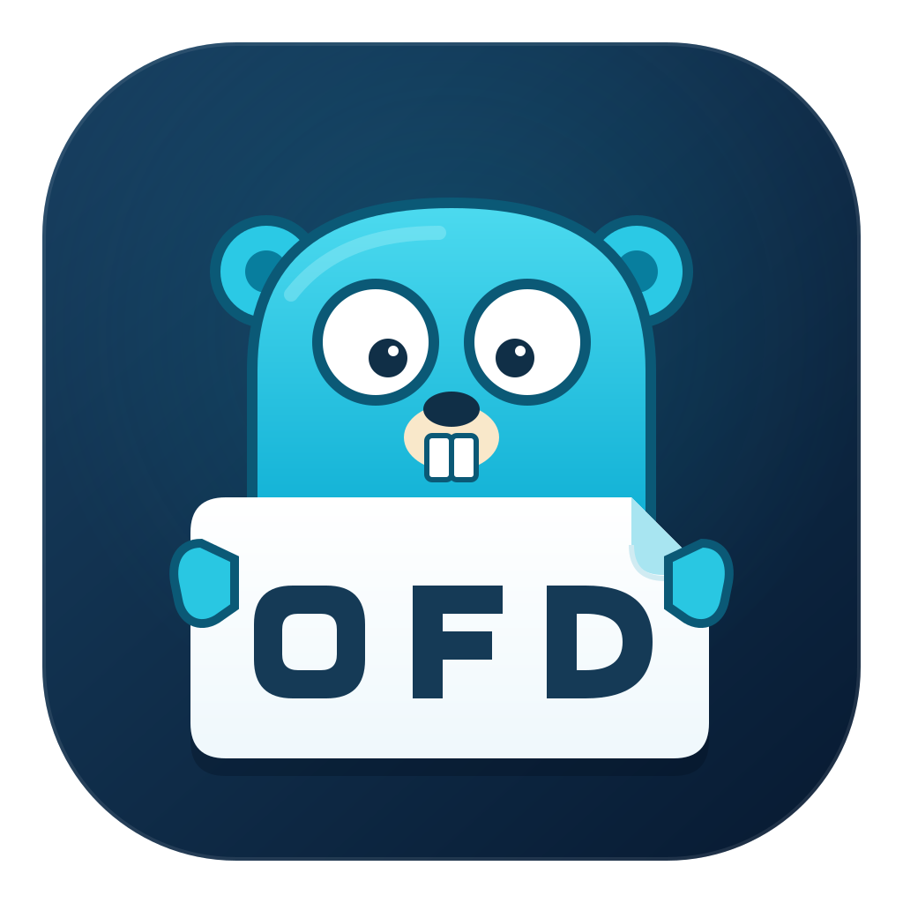

<p align="center">
  <a href="docs/branding/README.md">
    
  </a>
</p>

<h1 align="center">OFD Go Toolkit</h1>

<p align="center">
  <a href="https://pkg.go.dev/github.com/zc310/ofd"></a>
  <a href="https://github.com/zc310/ofd/releases/latest"></a>
  <a href="https://github.com/zc310/ofd/actions/workflows/go.yml"></a>
  <a href="https://coveralls.io/github/zc310/ofd?branch=main"></a>
  <a href="https://github.com/zc310/ofd/stargazers"></a>
</p>

用 Go 解析、创建、转换、渲染、校验和分析 OFD 文档。提供 Go API、命令行工具、
HTTP 服务，以及桌面、Android 和浏览器阅读器。

| 想做什么 | 入口 |
|---|---|
| 在线体验 | [OFD Toolbox](https://zc310.github.io/ofd-toolbox/)（覆盖本库大部分功能）；[浏览器阅读器](https://zc310.github.io/ofd/wasm/)；[Fyne Web 阅读器](https://zc310.github.io/ofd/fyne/) |
| 下载应用或命令行工具 | [GitHub Releases](https://github.com/zc310/ofd/releases)、[发布包下载指南](docs/RELEASE-ASSETS.md)（文件名、系统与架构对应表） |
| 转换、创建和检查文档 | [快速开始](#快速开始)、[功能特性](#功能特性) |
| 选择桌面、Android 或浏览器阅读器 | [阅读器](#阅读器) |
| 让 AI 调用命令行工具 | [CLI Skill](SKILL.md)（工具选择、命令示例与安全边界） |
| 接入自己的 Go 项目 | [Go API](#go-api)、[库使用指南](docs/GO-API.md) |
| 组合签名、加密与完整性保护 | [安全能力指南](docs/SECURITY.md) |
| 从源码运行和打包 | [构建与打包](#构建与打包)、[构建指南](docs/BUILDING.md) |
| 查询兼容性与标准资料 | [支持清单](#支持清单与工具文档)、[文档目录](docs/README.md) |

## 快速开始

下载 [Release](https://github.com/zc310/ofd/releases) 中对应平台的命令行程序后运行；
文件名中的 `darwin` 表示 macOS，`amd64` 适用于 Intel/AMD 64 位电脑，完整对应表见
[发布包下载指南](docs/RELEASE-ASSETS.md)。

从源码运行时，在仓库根目录将程序名替换为 `go run ./cmd/工具名`，例如
`go run ./cmd/ofd-converter input.ofd output.pdf`。工具链与构建依赖见[构建与打包](#构建与打包)。

### 转换文档

```bash
# OFD 转 PDF
ofd-converter input.ofd output.pdf

# 首页输出为 PNG；页码从 1 开始
ofd-converter --page 1 --dpi 150 input.ofd page1.png

# 多页图片输出为 ZIP
ofd-converter --format png input.ofd pages.zip

# PDF 转 OFD
ofd-converter input.pdf output.ofd
```

`ofd-converter` 默认使用 150 DPI 和白色背景，`--page` 使用多文档体合并后的全局页码。
OFD 转 PDF 默认不新增有损图片压缩；`--pdf-lossy-images` 可允许图片颜色转 JPEG，
透明蒙版仍无损保存。PNG 编码速度可通过 `--png-compression-level` 调整，像素保持无损。
批量转换、完整选项和退出码见 [转换工具说明](cmd/ofd-converter/README.md)。

常规 OFD 转 PDF、图片及 PDF、CSV/TSV 导入使用 Go 实现。Office、HTML、EML、SVG、XPS 和 OCR 的
外部工具要求见 [运行依赖](docs/BUILDING.md#运行依赖)，PDF 的可选 OpenJPEG 后端见
[PDF 支持清单](docs/PDF-SUPPORT.md)。

### 创建与检查

```bash
# 从 YAML 或 JSON 清单创建 OFD
ofd-creator -i document.yaml -o result.ofd --validate

# 校验与分析
ofd-validator --format text input.ofd
ofd-analyzer --format json input.ofd

# 多份文档与第一份比较，生成可离线查看的图文差异报告
ofd-compare -o comparison.html original.ofd revised.ofd final.ofd
```

创建清单见 [creator 示例](cmd/ofd-creator/examples)；大对比报告可使用
[`--external-images`](cmd/ofd-compare/README.md) 将图片保存到报告旁。

### 加密与解密

```bash
# 口令文件按原始 UTF-8 字节读取，保留空格和换行
ofd-crypt encrypt --password-file password.txt -o encrypted.ofd input.ofd
ofd-crypt decrypt --password-file password.txt -o plain.ofd encrypted.ofd
```

GM/T 0099-2020 加解密使用不提供认证的 CBC；解密成功不证明内容未被篡改、证书可信或签名有效。
重要场景请独立验证签名和完整性证据，组合方式见[安全能力指南](docs/SECURITY.md)，
格式约定与限制见[密码功能说明](docs/OFD-CRYPTO.md)。

## 功能特性

| 场景 | 能力与工具 |
|---|---|
| 文档转换 | [ofd-converter](cmd/ofd-converter/README.md)：OFD 导出 PDF、DOCX、HTML、文本、Markdown、PNG/JPG、TIFF、SVG；PDF、Markdown、Office、HTML/MHTML、图片、XPS、EML、SVG、CSV/TSV 导入 OFD。 |
| 创建与编辑 | [ofd-creator](cmd/ofd-creator/README.md)：JSON/YAML 清单、数据模板与配置导出；流式自动排版、主题、提示框、表格与公文基础版式；合并、拆分、选页重排、页面叠加、水印与条目替换。 |
| 规范校验 | [ofd-validator](cmd/ofd-validator/README.md)：检查 ZIP、XML、XSD、引用、语义与摘要，提供分阶段状态和问题定位。 |
| 结构分析 | [ofd-analyzer](cmd/ofd-analyzer/README.md)：分析文档、页面、资源、附件、注解与签名，提供结构化诊断、静态 URI 审计和资源依赖闭包；不代替规范校验。 |
| 文档对比 | [ofd-compare](cmd/ofd-compare/README.md)：比较目录、摘要、XML、文字和画面，支持页配对、局部放大与外置图片；输出 HTML、JSON、文本和 Markdown。 |
| 档案预检与处理 | [ofd-archive](cmd/ofd-archive/README.md)：技术清单、归档准备目录、符合性矩阵与 SHA-256 固定性验证；[preserve](cmd/ofd-archive/README.md#长期保存处理preserve) 提供长期保存转换与改动计划。 |
| 发票处理 | [ofd-invoice](cmd/ofd-invoice/README.md)：增值税电子发票、铁路电子客票抽取，支持结构化附件与自定义标引，JSON/CSV/XLSX 汇总、去重、自校验与 PDF 合并打印。 |
| 电子印章与签名 | [ofd-seal](cmd/ofd-seal/README.md) 生成 SES V4 SM2/SM3 印章；[`pkg/sign`](pkg/sign/README.md) 支持签章、SM2/RSA/ECDSA 普通数字签名、外部签署与完整验证；[ofd-creator](cmd/ofd-creator/README.md#独立签署与普通签名追加) 支持签名追加和[移除](cmd/ofd-creator/README.md#移除与清理已有签名)。 |
| OFD 加解密 | [ofd-crypt](cmd/ofd-crypt/README.md)：口令/证书、多接收者、整包/条目/页面范围加密、多层解密和只读解密视图。 |
| 完整性保护 | [`pkg/integrity`](pkg/integrity/README.md) 与 [ofd-crypt integrity](cmd/ofd-crypt/README.md)：带时间戳清单、物理集合、内容覆盖及引用闭包检查。 |
| 阅读器 | [桌面、Android 与浏览器阅读器](#阅读器)，提供独立应用、在线入口和 WASM API。 |
| HTTP 服务 | [ofd-server](cmd/ofd-server/README.md)：同步流输出、异步转换任务、远程产物传输及 OpenAPI 在线文档。 |
| Linux 桌面集成 | [ofd-thumbnailer](cmd/ofd-thumbnailer/README.md)：OFD 首页及 ZIP 包内图片缩略图，加密 OFD 显示固定挂锁图案；提供 ZIP、DEB 和 RPM 安装包。 |

校验器与分析器均支持文本、Markdown、JSON、OFD、PDF 和 XLSX 报告。OFD/PDF 报告使用统一的
Material 主题，以提示框突出状态与检查范围，问题明细支持跨页表格；未执行的检查不代表通过。

电子证照的 `TypeID="cert"` 标引入口支持创建、读取及 JSON/YAML 清单往返。
独立校验使用 `ofd-validator --custom-tag-type-id`；该开关仅覆盖标引入口，
尚不代表 GB/T 36905 全面合规。用法和范围见
[创建示例](cmd/ofd-creator/README.md#电子证照标引入口)。
基础元数据与标识本地检查另用 `ofd-validator --certificate-metadata`
（Go API：`validator.WithCertificateMetadata(true)`），支持必选项、标准短名、
MOD 37,36、日期及多值对应；不验证登记、授权、签名或全面合规。
规则范围及标准示例差异见 [证照库说明](pkg/certificate/README.md)。
原件锁定、移除明确指定的旧锁定签名后制作加注件及重新验收，使用独立 Go API
[`pkg/certificate/workflow`](pkg/certificate/workflow/README.md)。它要求完整信任、
吊销证据与外部机构角色授权，不把数学验签或元数据格式通过当作证照业务可信。

签名验收应检查完整结论 `Result.FullyValid()`，而非仅检查数学验签结果。
外部签署协议示例见 [ofd-signer-demo](cmd/ofd-signer-demo/README.md)。

## Go API

在已有 Go 项目中添加依赖，Go 工具链要求以 [go.mod](go.mod) 为准：

```bash
go get github.com/zc310/ofd@latest
```

下面是一个完整的 OFD 转 PDF 示例。转换入口的首参是 `context.Context`，长任务可传入
带取消或超时的上下文：

```go
package main

import (
	"context"
	"log"
	"os"

	"github.com/zc310/ofd/pkg/converter"
)

func main() {
	output, err := os.Create("output.pdf")
	if err != nil {
		log.Fatal(err)
	}

	err = converter.PDF(context.Background(), "input.ofd", output)
	closeErr := output.Close()
	if err != nil {
		log.Fatal(err)
	}
	if closeErr != nil {
		log.Fatal(closeErr)
	}
}
```

| 需求 | Go 入口 |
|---|---|
| 标准常量与 XML 声明模型 | [`pkg/spec`](https://pkg.go.dev/github.com/zc310/ofd/pkg/spec)、[公开范围与使用边界](docs/GO-API.md#标准数据模型) |
| 转换与渲染 | [`pkg/converter`](https://pkg.go.dev/github.com/zc310/ofd/pkg/converter)、[可运行示例](pkg/converter/examples_test.go) |
| 导入 PDF、Markdown 等格式 | [按需注册导入器](docs/GO-API.md#导入其他格式)、[Markdown 排版与字体](pkg/converter/import/markdown/README.md) |
| 按页渲染、文字、搜索与导航 | [`pkg/reader`](https://pkg.go.dev/github.com/zc310/ofd/pkg/reader)、[接入示例](docs/GO-API.md#接入按页阅读接口) |
| 创建 OFD 与流式写出 | [`pkg/creator` 库指南](pkg/creator/README.md) |
| 自动排版、主题与提示框 | [`pkg/creator/flow` 流式创作](pkg/creator/flow/README.md)、[Callout 提示框](pkg/creator/flow/README.md#提示框-callout) |
| 多文档合并、拼页和重排 | [`pkg/creator/merge`](https://pkg.go.dev/github.com/zc310/ofd/pkg/creator/merge)、[合并与选页说明](cmd/ofd-creator/README.md#合并多个-ofd) |
| 按范围、每 N 页或文档体拆分 | [`pkg/creator/split` 库指南](pkg/creator/split/README.md)、[拆分命令](cmd/ofd-creator/README.md#拆分-ofd) |
| 条目编辑与水印 | [`pkg/creator/replace`](https://pkg.go.dev/github.com/zc310/ofd/pkg/creator/replace)、[`pkg/creator/watermark`](https://pkg.go.dev/github.com/zc310/ofd/pkg/creator/watermark) |
| 签署、生成印章和验证 | [`pkg/sign` 库指南](pkg/sign/README.md) |
| 检查加密元数据与加解密 OFD | [`pkg/crypt` 库指南](pkg/crypt/README.md)、[密码功能与实现约定](docs/OFD-CRYPTO.md) |
| 整包完整性检查及安全能力组合 | [`pkg/integrity` 库指南](pkg/integrity/README.md)、[安全能力指南](docs/SECURITY.md) |
| 文档对比 | [`pkg/compare` 库指南](pkg/compare/README.md) |
| 长期保存转换与改动计划 | [`pkg/archive/preserve`](https://pkg.go.dev/github.com/zc310/ofd/pkg/archive/preserve)、[输入限制与处理边界](cmd/ofd-archive/README.md#长期保存处理preserve) |

### 接入约定

- **输入与输出**：输入类型、页码、DPI、缓存和字体等细节见 [Go API 使用指南](docs/GO-API.md)。
  转换取消或失败后应丢弃部分输出，并处理调用方输出文件的关闭错误。
- **文档权限**：阅读、导出、编辑和签署等入口执行对应权限及有效期检查，策略与显式诊断授权见
  [阅读器权限策略](docs/GO-API.md#阅读器权限策略)。归档检查、原件保存与长期保存处理属于独立用途，
  不因声明或过期拒绝；业务归档授权与访问控制由调用方负责，普通阅读/导出权限不因此豁免。
- **JSON 契约**：请求、配置和创建清单的字段名区分大小写，同一对象中的字段不能重复。
  报告与服务响应应按字段解析，map 键不保证输出顺序。

独立应用接入示例：[ofd-viewer](https://github.com/zc310/ofd-viewer)、
[ofd-toolbox](https://github.com/zc310/ofd-toolbox)。

## 阅读器

### 阅读器入口

| 阅读器 | 平台 | 定位与入口 |
|---|---|---|
| [ofd-viewer（Fyne）](cmd/ofd-viewer/README.md) | Windows、macOS、Linux、Android | 默认桌面阅读器；连续阅读、缩略图、多种页面视图、中英文界面及 PDF/图片/文本导出。 |
| [ofd-wasm](cmd/ofd-wasm/README.md) | 浏览器 | [在线阅读](https://zc310.github.io/ofd/wasm/)；文字选择、搜索、导航、图层、附件和签名检查，提供 WASM API 与 Worker 协议。 |
| [Fyne Web](cmd/ofd-viewer/README.md#web-打包) | 浏览器 | [在线体验](https://zc310.github.io/ofd/fyne/)；与 Fyne 桌面和 Android 共用界面，需要 WebAssembly 与 WebGL。 |
| [ofd-viewer-wails](cmd/ofd-viewer-wails/README.md) | Windows、macOS、Linux、Android | **实验性**；原生 Go 渲染，与浏览器共用界面，支持搜索、导航、附件预览、导出及桌面打印。 |
| [ofd-viewer-gio](cmd/ofd-viewer-gio/README.md) | Windows、macOS、Linux | **实验性**；验证 GPU 矢量重放，支持单页/连续/双页阅读、缩略图与导出，尚不是高保真替代品。 |

浏览器版本在本地处理文档，本地启动方式见 [WASM 构建与运行](docs/BUILDING.md#浏览器阅读器)。
加密文档解锁、附件与媒体预览、导出范围及资源预算见对应阅读器文档；印章预览不代表签名有效或证书可信。
Wails 与 Gio 使用独立构建入口，不替代默认 Fyne 阅读器；Wails Android 暂不支持原生打印。

### 桌面版系统要求对照

系统支持范围同时受 Go 工具链、界面框架和实际产物的动态库依赖限制。
依赖版本以 [go.mod](go.mod) 为准；下表是运行条件，不代表所有系统组合均已实机验证。

| 平台 | Fyne 版 `ofd-viewer` | Wails 版 `ofd-viewer-wails` |
|---|---|---|
| Windows | Windows 10/11，需要 OpenGL 图形驱动，不依赖 WebView2 | Windows 10/11，需要 WebView2 Runtime；安装包不捆绑该运行时 |
| macOS | 最低系统版本取决于实际构建使用的 Go 工具链 | 同样受 Go 工具链限制，另需系统 WKWebView 支持界面所用的网页功能 |
| Linux | X11/Wayland、OpenGL 及相应运行库，不依赖 GTK/WebKit | 默认 GTK4、WebKitGTK 6.0 及桌面图形环境，以 Ubuntu 24.04+ 为发行适配目标 |
| Android | 目标为 Android 5.0 / API 21 及以上，实际要求以 APK 为准 | Android 7.0 / API 24 及以上，ARM64 / x86_64，需现代系统 WebView |

两版正式 Windows 构建均不支持 Windows 7/8/8.1。Linux CGO 产物受构建机 glibc 和图形库版本约束，
在新发行版编译不代表能在旧发行版运行；应在计划支持的最老目标系统上构建并验证。
详细版本与依赖见 [Fyne 系统要求](cmd/ofd-viewer/README.md#系统要求)、
[Wails 系统要求](cmd/ofd-viewer-wails/README.md#系统要求)，移动端差异见
[Wails Android 说明](cmd/ofd-viewer-wails/README.md#android-构建与差异)。

## 构建与打包

需要 Go 1.27 或更高版本，具体要求以 [go.mod](go.mod) 为准。在仓库根目录执行，发行版本由
[Makefile](Makefile) 的 `VERSION` 统一注入：

```bash
# 当前平台的命令行工具
make build-tools

# 当前平台的命令行工具 ZIP 包
make package-tools

# 当前平台的桌面阅读器与命令行工具包
make package-desktop
```

构建输出默认位于 `/tmp/ofd/.build`，发布包位于 `/tmp/ofd/dist`，可通过
`BUILD_DIR`、`DIST_DIR` 覆盖。默认 `make` 还会生成 Linux 缩略图 DEB 和 RPM，需先安装
nFPM（`make install-nfpm` 并将 Go bin 目录加入 PATH，或设置 `NFPM`）。
Android、WASM、交叉编译、系统依赖与 Windows 7
兼容工具链的试编译说明见 [构建指南](docs/BUILDING.md)。

### 实验性渲染后端

- [Gio GPU 栅格后端](internal/render/backends/giogpu/README.md)：提供自动 CPU 回退、严格 GPU
  入口和累计回退诊断，尚未作为默认转换后端。
- [pdfcpu PDF 写入后端](internal/pdfcpuwriter/README.md#构建标签注册)：可用
  `go build -tags pdfcpu ./cmd/ofd-converter` 注册；不加标签仍使用 canvas。

### 内置绘图与字体库维护

绘图与字体解析代码分别维护在 [`internal/thirdparty/canvas`](internal/thirdparty/canvas/README.ofd.md)
和 [`internal/thirdparty/font`](internal/thirdparty/font/README.ofd.md)，不再依赖外部
`github.com/tdewolff/canvas`、`github.com/tdewolff/font` 模块或本地 workspace。
来源、MIT 许可、裁剪范围与测试入口见各自说明。两者均不附带字体文件；
文档内嵌字体和系统字体回退策略不变。

## 支持清单与工具文档

支持清单区分已支持、部分支持和暂不支持，记录能力边界与兼容处理：

| 格式 | 支持范围与限制 |
|---|---|
| OFD | [解析、创建、渲染、校验与阅读](docs/OFD-SUPPORT.md) |
| PDF | [PDF 转 OFD、资源预算与诊断](docs/PDF-SUPPORT.md) |
| Office | [Office 转 OFD/PDF](docs/OFFICE-SUPPORT.md) |
| HTML/MHTML | [浏览器打印与格式转换](docs/HTML-SUPPORT.md) |
| CSV/TSV | [表格导入、编码与字体](docs/CSV-SUPPORT.md) |
| EML 邮件 | [邮件正文、CID 图片与原附件保留](docs/EML-SUPPORT.md) |
| SVG | [矢量图导入与纸张设置](docs/SVG-SUPPORT.md) |

工具的参数与退出码见[功能表中的文档](#功能特性)。标准资料、截图与维护入口汇总在
[文档目录](docs/README.md)；已发布接口的破坏性变更见 [CHANGELOG](CHANGELOG.md)。
指定版本的性能测试见 [ofd-performance](https://github.com/zc310/ofd-performance)，结果见[性能趋势](https://zc310.github.io/ofd-performance/)。
交叉库性能对比见 [ofd-benchmark](https://github.com/zc310/ofd-benchmark)，实际表现取决于
文档样本、字体、操作系统和运行环境。

## OFD 简介

OFD（Open Fixed-layout Document）是中国电子文件领域常用的版式文档格式，适用于
电子证照、电子发票、数字档案和公文。文件通常以 ZIP 容器组织 XML、页面、文字、
路径、图片、字体、附件和签名等资源，并保留相应的布局和绘制信息。

GB/T 33190-2016 等标准的官方查询链接见[标准资料索引](docs/README.md#标准资料)。
项目不随仓库分发标准全文；不同生产方的扩展与兼容处理见 [OFD 支持清单](docs/OFD-SUPPORT.md)。

## 许可证

本项目基于 Apache License 2.0 发布，声明见 [LICENSE](LICENSE) 和 [NOTICE](NOTICE)。
第三方依赖的来源与许可见 [THIRD-PARTY-LICENSES](THIRD-PARTY-LICENSES)，测试样例来源见
[testdata/README.md](testdata/README.md)，项目图标的来源与许可见[图标说明](docs/branding/README.md)。

使用本项目及其输出结果前，请阅读 [免责声明](DISCLAIMER.md)。本项目不保证所有 OFD
文件的解析、转换、校验或渲染结果适用于特定业务、法律或合规场景。如发现仓库、文档
或示例中可能存在侵权内容，请通过 [GitHub Issues](https://github.com/zc310/ofd/issues/new)
联系维护者。
